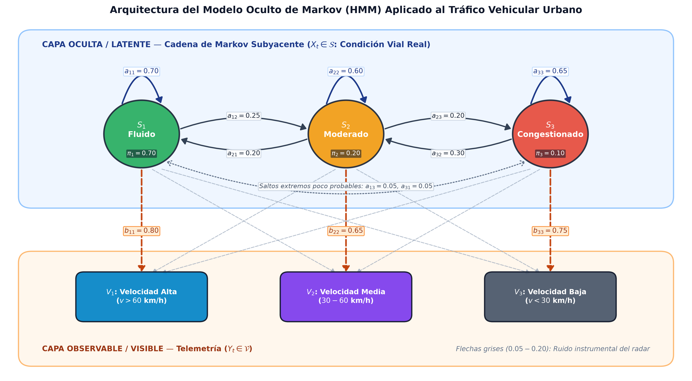
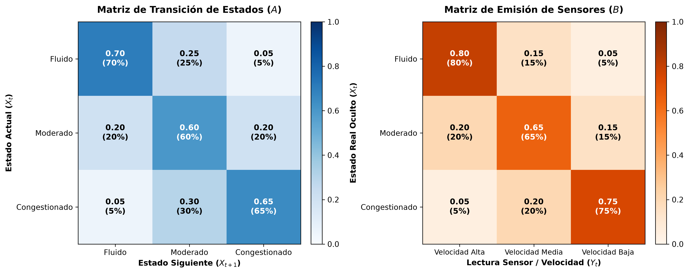
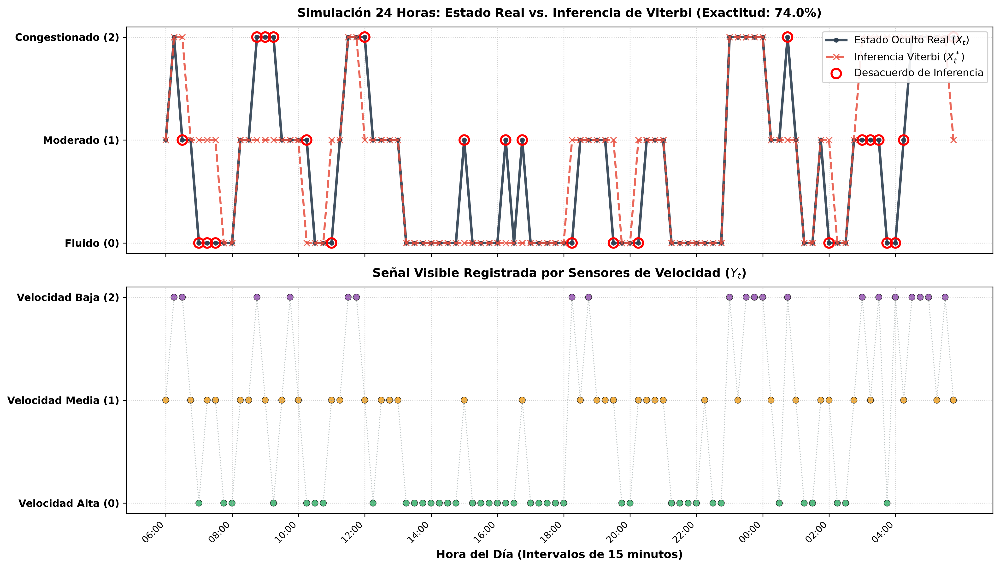
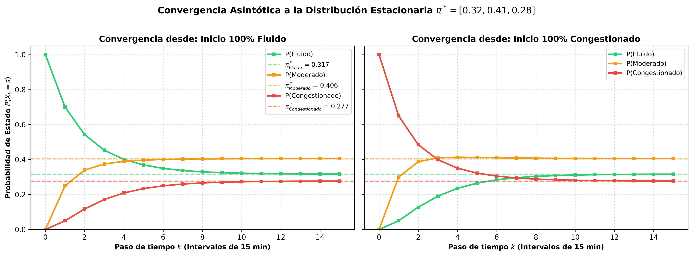
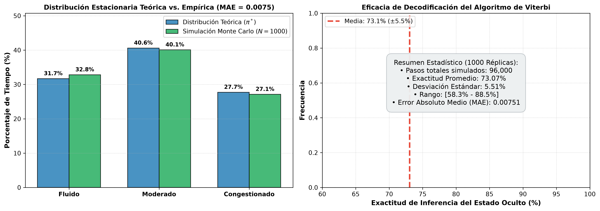
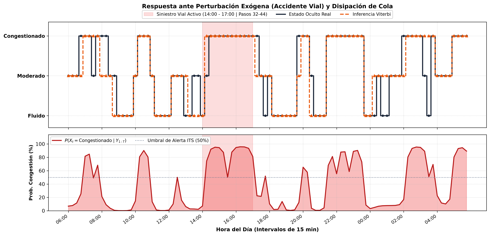
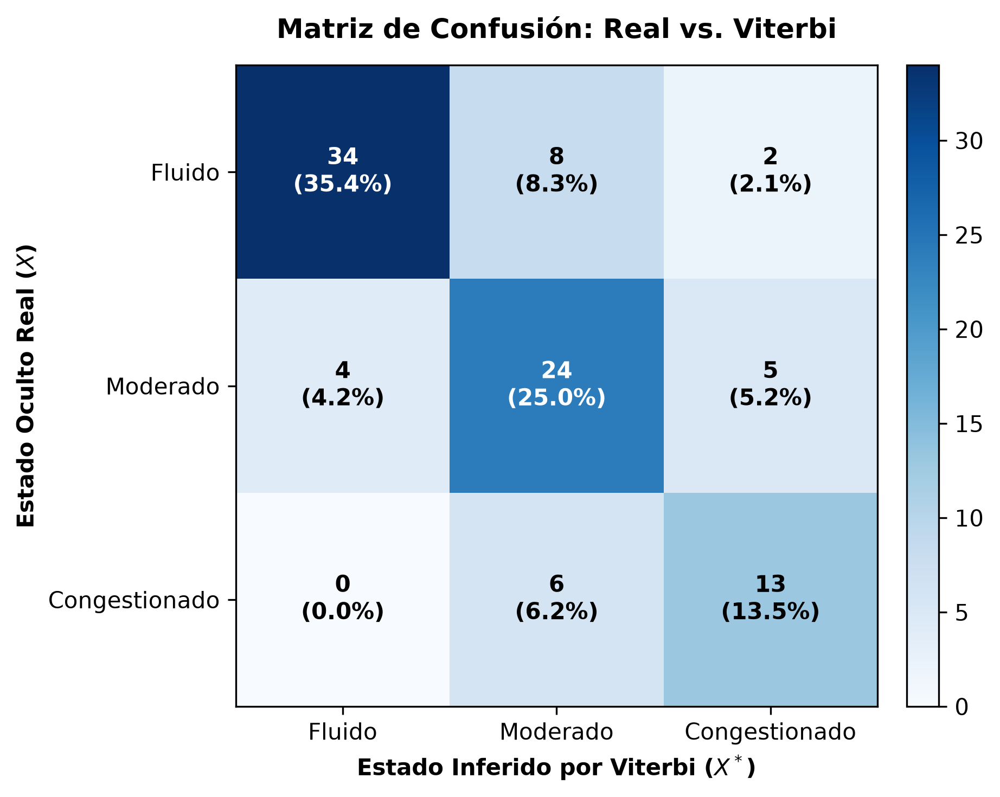

# Simulación Estocástica de Tráfico Vehicular con Modelo Oculto de Markov (HMM)

[](https://colab.research.google.com/github/Camilo-Alberto-Palacio/Simulacion-Trafico-Markov/blob/main/Simulacion_Markov_Trafico_Colab.ipynb)


Implementación matemática, computacional y experimental de un **Modelo Oculto de Markov (Hidden Markov Model — HMM)** de tiempo discreto para modelar, simular, filtrar e inferir la dinámica estocástica del tráfico vehicular en un corredor arterial urbano.

Proyecto desarrollado para la **Actividad Didáctica 2 — Módulo 2: Distribuciones de Probabilidad y Procesos Estocásticos** de la asignatura **Simulación (`PREICA2602B020045`)** en la **Institución Universitaria Digital de Antioquia (IU Digital)**.

---

## Tabla de Contenidos
1. [Descripción del Problema y Justificación del HMM](#descripción-del-problema-y-justificación-del-hmm)
2. [Formulación Matemática](#formulación-matemática)
3. [Algoritmos Implementados](#algoritmos-implementados)
4. [Estructura del Repositorio](#estructura-del-repositorio)
5. [Instalación e Instrucciones de Ejecución](#instalación-e-instrucciones-de-ejecución)
6. [Resultados Principales y Visualizaciones](#resultados-principales-y-visualizaciones)
7. [Equipo de Trabajo (Grupo 25)](#equipo-de-trabajo-grupo-25)
8. [Licencia](#licencia)

---

## Descripción del Problema y Justificación del HMM

En la gestión de Sistemas Inteligentes de Transporte (ITS) sobre arterias urbanas (p. ej., Autopista Norte / Avenida Regional en Medellín), existe una separación física intrínseca entre el fenómeno vial y su telemetría:

1. **Capa Oculta / Latente ($X_t \in \mathcal{S}$):** El verdadero régimen macroscópico de congestión del corredor (**Fluido**, **Moderado**, **Congestionado**) es una propiedad espacialmente distribuida que **no es directamente observable** desde un punto fijo.
2. **Capa Observable / Visible ($Y_t \in \mathcal{V}$):** Los radares Doppler y espiras inductivas reportan mediciones puntuales discretizadas (**Velocidad Alta**, **Velocidad Media**, **Velocidad Baja**) contaminadas con **ruido instrumental y varianza microscópica** (p. ej., un vehículo pesado frenando en vía fluida o una aceleración momentánea entre colas dentro de un embotellamiento).



Un clasificador ingenuo sin memoria oscila erráticamente ante cada lectura atípica del sensor. El **HMM** acopla la inercia física markoviana ($A$) con el modelo de incertidumbre del sensor ($B$), reconstruyendo de forma óptima la trayectoria real del tráfico.

---

## Formulación Matemática

El sistema se discretiza en intervalos de $\Delta t = 15\text{ minutos}$ ($T = 96$ pasos por jornada de 24 horas) mediante la quíntupla $\lambda = (\mathcal{S}, \mathcal{V}, \pi, A, B)$:

* **Espacio de Estados Ocultos ($\mathcal{S}$, $N = 3$):**
  * $S_1 = \text{Fluido}$ ($k \le 15\text{ veh/km/carril}$, flujo libre).
  * $S_2 = \text{Moderado}$ ($15 < k \le 35\text{ veh/km/carril}$, flujo estable condicionado).
  * $S_3 = \text{Congestionado}$ ($k > 35\text{ veh/km/carril}$, saturación *stop-and-go*).
* **Espacio de Observaciones Visibles ($\mathcal{V}$, $M = 3$):**
  * $V_1 = \text{Velocidad Alta}$ ($v > 60\text{ km/h}$), $V_2 = \text{Velocidad Media}$ ($30 \le v \le 60\text{ km/h}$), $V_3 = \text{Velocidad Baja}$ ($v < 30\text{ km/h}$).
* **Vector de Probabilidades Iniciales (06:00 AM):**
  $$\pi = [0.70,\; 0.20,\; 0.10]$$
* **Matriz de Transición de Estados ($A$) y Matriz de Emisión de Sensores ($B$):**

$$A = \begin{pmatrix}
0.70 & 0.25 & 0.05 \\
0.20 & 0.60 & 0.20 \\
0.05 & 0.30 & 0.65
\end{pmatrix}, \qquad
B = \begin{pmatrix}
0.80 & 0.15 & 0.05 \\
0.20 & 0.65 & 0.15 \\
0.05 & 0.20 & 0.75
\end{pmatrix}$$

---

## Algoritmos Implementados

1. **Validación Axiomática de Kolmogorov:** Verificación automática de no-negatividad y estocasticidad por filas ($\sum_i \pi_i = 1$, $\sum_j a_{ij} = 1$, $\sum_k b_{jk} = 1$).
2. **Simulador Monte Carlo (`TrafficHMM.simulate`):** Generación estocástica reproducible mediante `numpy.random.default_rng` (PCG64).
3. **Algoritmo de Viterbi en Log-Espacio (`TrafficHMM.viterbi`):** Programación dinámica $\mathcal{O}(T \cdot N^2)$ para hallar la secuencia conjunta óptima $X^*_{1:T} = \arg\max_X P(X, Y \mid \lambda)$ sin *underflow* aritmético.
4. **Suavizado Bayesiano Forward-Backward (`TrafficHMM.forward_backward`):** Variables escaladas $\hat{\alpha}_t, \hat{\beta}_t$ para calcular la certidumbre marginal a posteriori $\gamma_t(i) = P(X_t = s_i \mid Y_{1:T}, \lambda)$ y la log-verosimilitud exacta $\ln P(Y_{1:T} \mid \lambda)$.
5. **Análisis Ergódico Exacto:** Distribución estacionaria $\pi^* A = \pi^*$ ($\pi^* = [32/101, 41/101, 28/101]$), tiempos medios de permanencia geométrica $\mathbb{E}[T_i] = \frac{1}{1 - a_{ii}}$ y tiempos medios de retorno de Kac $\mu_i = \frac{1}{\pi^*_i}$.

---

## Estructura del Repositorio

```text
.
├── traffic_hmm/                              # Paquete modular principal en Python
│   ├── __init__.py                           # Exportación pública de clases
│   ├── model.py                              # Motor matemático TrafficHMM (Viterbi, Forward-Backward, pi*)
│   ├── simulation.py                         # Escenarios 24h, Monte Carlo (1,000 réplicas) e incidentes
│   └── visualizations.py                     # Generador de 7 figuras científicas a 300 DPI
├── tests/                                    # Suite automatizada de pruebas unitarias
│   └── test_hmm.py                           # 7 pruebas de invariancia, ergodicidad e inferencia
├── results/                                  # Evidencias gráficas (300 DPI) y datos tabulares CSV
│   ├── fig0_diagrama_estructura_hmm.png
│   ├── fig1_matrices_transicion_emision.png
│   ├── fig2_simulacion_jornada_24h.png
│   ├── fig3_convergencia_distribucion_estacionaria.png
│   ├── fig4_validacion_monte_carlo.png
│   ├── fig5_escenario_incidente_recuperacion.png
│   ├── fig6_matriz_confusion_viterbi.png
│   ├── simulacion_jornada_24h.csv
│   └── resumen_modelo_markov.csv
├── main.py                                   # Script principal CLI (ejecuta todo el pipeline)
├── Simulacion_Markov_Trafico_Colab.ipynb     # Cuaderno auto-contenido y pre-ejecutado para Google Colab
├── create_colab_notebook.py                  # Constructor y ejecutor automático del notebook
├── generate_doc.py                           # Generador automatizado del informe académico Word
├── Evidencia de Aprendizaje 2 - Módulo 2. Actividad didáctica 2 - Modelo de Markov.docx # Informe escrito oficial entregable
├── GUION_VIDEO_SUSTENTACION.md               # Guion estructurado minuto a minuto para el video
├── requirements.txt                          # Dependencias científicas reproducibles
├── LICENSE                                   # Licencia MIT del equipo
└── README.md                                 # Documentación técnica del repositorio
```

---

## Instalación e Instrucciones de Ejecución

### Opción A: Ejecución en la Nube con 1 Clic (Google Colab)
Haz clic en el botón **Open in Colab** al inicio de este documento y selecciona `Entorno de ejecución -> Ejecutar todas` (no requiere instalar nada localmente).

### Opción B: Ejecución Local desde Terminal
```bash
# 1. Clonar el repositorio
git clone https://github.com/Camilo-Alberto-Palacio/Simulacion-Trafico-Markov.git
cd Simulacion-Trafico-Markov

# 2. Crear y activar entorno virtual (recomendado)
python -m venv venv
venv\Scripts\activate        # En Windows
# source venv/bin/activate   # En Linux / macOS

# 3. Instalar dependencias
pip install -r requirements.txt

# 4. Ejecutar la simulación completa y regenerar CSVs + las 7 figuras a 300 DPI
python main.py

# 5. Ejecutar la suite de pruebas unitarias (7 verificaciones matemáticas)
python -m unittest discover -s tests -v

# 6. Regenerar el informe académico oficial en Word (.docx)
python generate_doc.py
```

---

## Resultados Principales y Visualizaciones

### Síntesis Cuantitativa del Modelo

| Estado Oculto | Dist. Estacionaria ($\pi^*$) | Frecuencia Monte Carlo (`96k` pasos) | Permanencia Continua $\mathbb{E}[T_i]$ | Retorno Medio de Kac ($\mu_i$) |
| :--- | :---: | :---: | :---: | :---: |
| **Fluido ($S_1$)** | `31.68%` (`32/101`) | `32.81%` | `3.33` pasos (`50.0 min`) | `3.16` pasos (`47.3 min`) |
| **Moderado ($S_2$)** | `40.59%` (`41/101`) | `40.07%` | `2.50` pasos (`37.5 min`) | `2.46` pasos (`37.0 min`) |
| **Congestionado ($S_3$)** | `27.72%` (`28/101`) | `27.12%` | `2.86` pasos (`42.9 min`) | `3.61` pasos (`54.1 min`) |

| Método de Decodificación (`1,000` Réplicas Monte Carlo) | Exactitud Media ($\pm\text{DE}$) | Conmutaciones Diarias Medias | Desempeño Operativo |
| :--- | :---: | :---: | :--- |
| **Sensor Crudo Sin Memoria (Baseline)** | `72.44% (±4.53%)` | `50.9` cambios/día | Sobre-oscilación severa por ruido |
| **Algoritmo de Viterbi (Ruta MAP Global)** | **`73.07% (±5.51%)`** | **`21.5` cambios/día** | **Suprime el `57.8%` del ruido espurio** |
| **Suavizado Forward-Backward ($\gamma_t$)** | **`74.04% (±4.95%)`** | `35.7` cambios/día | Máxima exactitud marginal (`Real = 33.7`) |

---

### 1. Matrices Estocásticas de Transición ($A$) y Emisión ($B$)


### 2. Jornada de 24 Horas: Viterbi, Certidumbre Posterior ($\gamma_t$) y Telemetría


### 3. Convergencia Ergódica a la Distribución Estacionaria ($\pi^*$)


### 4. Validación Monte Carlo (`1,000` Réplicas = `96,000` Pasos, $\text{MAE} = 0.0075$)


### 5. Contingencia por Accidente Vial (`14:00 – 17:00`) y Disipación de Cola


### 6. Matriz de Confusión Normalizada por Sensibilidad
Registra **`0.0%` de falsos negativos críticos** en episodios reales de congestión (`Congestionado -> Fluido = 0/19`), garantizando seguridad operativa para el control semafórico.



---

## Equipo de Trabajo (Grupo 25)

* **Adriana Andrea Agudelo Agudelo**
* **Camilo Alberto Palacios Turriago**
* **Juan Daniel Pulgarin García**
* **Ruben Dario Jaramillo Cervantes**

**Docente:** Julian Andres Loaiza Lopez  
**Asignatura:** Simulación — `PREICA2602B020045`  
**Institución:** Institución Universitaria Digital de Antioquia (IU Digital) — Facultad de Ingeniería  
**Sede y Fecha:** Medellín, Antioquia · Noviembre de 2026

---

## Licencia

Distribuido bajo la licencia **MIT**. Consulta el archivo [`LICENSE`](LICENSE) para más detalles.
